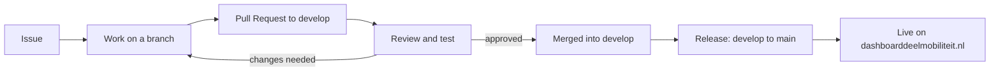

# Working together on Dashboard Deelmobiliteit

Thank you for helping to improve [Dashboard Deelmobiliteit](https://dashboarddeelmobiliteit.nl/)!

This guide explains how you can contribute. **You don't need to be a programmer.**
Most of the help we get is from people who use the dashboard every day: municipalities,
provinces, regions and shared mobility providers. They tell us what is broken, what is
missing and what could be easier.

Dashboard Deelmobiliteit is a project by the non-profit organisation [CROW](https://crow.nl/). From 2027 it will be managed by [DOVA](https://dova.nu/).

## Contents

- [The short version](#the-short-version)
- [Words you will come across](#words-you-will-come-across)
- [Reporting a bug](#reporting-a-bug)
- [Suggesting a new feature or improvement](#suggesting-a-new-feature-or-improvement)
- [What happens after you create an issue](#what-happens-after-you-create-an-issue)
- [From idea to live website: the Pull Request process](#from-idea-to-live-website-the-pull-request-process)
- [Urgent fixes (hotfixes)](#urgent-fixes-hotfixes)
- [Checklist for reviewing a Pull Request](#checklist-for-reviewing-a-pull-request)
- [For developers: practical agreements](#for-developers-practical-agreements)
- [Questions?](#questions)

## The short version

1. **Found a problem or have an idea?** Create an
   [issue on GitHub](https://github.com/Stichting-CROW/dashboarddeelmobiliteit-app/issues/new/choose),
   or send an email to [info@dashboarddeelmobiliteit.nl](mailto:info@dashboarddeelmobiliteit.nl).
2. **The team looks at it**, asks questions if needed and decides when it will be picked up.
3. **A developer builds the change** and offers it as a *Pull Request*.
4. **Someone else checks the change** before it is accepted.
5. **The change is collected** with other changes in the `develop` version.
6. **At a release**, all collected changes go live on dashboarddeelmobiliteit.nl at once,
   and are listed in the [release notes](RELEASES.md).

Writing in Dutch is perfectly fine. Use the language you are most comfortable with.

## Words you will come across

| Word | What it means |
| --- | --- |
| GitHub | The website where the code of the dashboard is stored and where we discuss changes. |
| Issue | A ticket on GitHub: a bug report, a feature request or a question. |
| Label | A colored tag on an issue, like `bug` or `enhancement`, to keep things organised. |
| Branch | A separate copy of the code where someone works on one change, without disturbing others. |
| Pull Request (PR) | A request to add the changes from a branch to the main code. Others can comment on it first. |
| Review | Checking a Pull Request: does it work, and is it what we wanted? |
| Merge | Accepting a Pull Request. The change becomes part of the main code. |
| `develop` | The branch where finished changes are collected before they go live. |
| `main` | The branch that *is* the live website. Everything in `main` is published automatically. |
| Release | The moment the collected changes from `develop` are published on the live website. |
| Test site | [test.dashboarddeelmobiliteit.nl](https://test.dashboarddeelmobiliteit.nl), where changes can be tried out before they go live. |

## Reporting a bug

A bug is something that doesn't work the way it should. For example: a chart that stays
empty, a wrong number, a button that does nothing, or an error message.

**Before you report:** take a quick look at the
[open issues](https://github.com/Stichting-CROW/dashboarddeelmobiliteit-app/issues) to see
if someone already reported the same problem. If so, add a comment with your own
experience instead of creating a new issue. That helps us see how many people are affected.

**To report a bug:**

1. Go to [New issue](https://github.com/Stichting-CROW/dashboarddeelmobiliteit-app/issues/new/choose)
   and choose **Bug report**. You need a (free) GitHub account for this. No account?
   Send the same information to [info@dashboarddeelmobiliteit.nl](mailto:info@dashboarddeelmobiliteit.nl).
2. Fill in the form. The most helpful information is:
   - **What did you do?** The steps that lead to the problem, e.g. *"I went to Statistiek >
     Beleidsinfo, selected Utrecht and the period of last month"*.
   - **What did you expect to happen?**
   - **What happened instead?**
   - **The link (URL) of the page.** The URL often contains your selection, so we can see
     exactly the same thing you do.
   - **A screenshot.** You can paste an image directly into the text field.
   - **Your browser and device**, e.g. *Chrome on a Windows laptop*, if you know.
3. Click **Submit new issue**.

**Please never share passwords or personal data in an issue.** Issues are public.
If the problem involves sensitive information, send an email instead.

## Suggesting a new feature or improvement

Do you miss something in the dashboard, or could something work better? We'd love to hear it.

1. Check the [open issues](https://github.com/Stichting-CROW/dashboarddeelmobiliteit-app/issues?q=is%3Aissue+is%3Aopen+label%3Aenhancement)
   to see if someone already suggested something similar. If so, give it a 👍 and add
   your own situation in a comment.
2. Otherwise, go to [New issue](https://github.com/Stichting-CROW/dashboarddeelmobiliteit-app/issues/new/choose)
   and choose **Feature request**.
3. Most important is to describe **the problem you want to solve**, not only the solution.
   For example:
   - Less helpful: *"Add a red button to the hubs page."*
   - More helpful: *"As a data analist I want to see which hubs were overloaded last month,
     so I can decide where to add capacity. Now I have to check every hub one by one."*
4. If you have a sketch, an example from another website or a screenshot, add it.

We can't build everything that is suggested. The team weighs each request against other
work, the available budget, and how many users would benefit. We will always let you know
what we decided and why.

## What happens after you create an issue

1. **Triage.** Someone from the team reads the issue, adds a [label](#labels-we-use) and asks
   follow-up questions if something is unclear. Please keep an eye on your GitHub
   notifications or email for these questions.
2. **Decision.** The team decides whether and when the issue will be picked up. An issue
   may also be closed if it is a duplicate, not reproducible, or something we won't do
   (label `wontfix`). We explain why in a comment.
3. **Work in progress.** When a developer starts working on it, the issue is assigned to
   them. The Pull Request will be linked to the issue, so you can follow progress.
4. **Done.** When the change is live, the issue is closed and the change is listed in the
   [release notes](RELEASES.md).

### Labels we use

| Label | Meaning |
| --- | --- |
| `bug` | Something isn't working. |
| `enhancement` | A new feature or an improvement. |
| `design` | About how the dashboard looks or feels. |
| `documentation` | About the documentation or help texts. |
| `question` | A question, or more information is needed. |
| `good first issue` | A small task, suitable for someone new to the code. |
| `help wanted` | We'd welcome help from outside the core team. |
| `duplicate` | This was already reported in another issue. |
| `wontfix` | We have decided not to do this. |

## From idea to live website: the Pull Request process

This is how a change travels from a developer's computer to the live website. Even if you
don't write code yourself, it helps to know these steps: you may be asked to test or
review a change.



### Step 1. Start from an issue

Every change starts with an issue, so it is clear *why* something is changed. Small
obvious fixes, like a typo, can skip this step.

### Step 2. Work on a separate branch

The developer creates a new branch from `develop` with a short, descriptive name, for
example `feat/hub-chart-with-capacity-line` or `fix/broken-images`. See
[branch names](#branch-names).

### Step 3. Open a Pull Request to `develop`

When the work is ready (or ready for feedback), the developer opens a Pull Request with
`develop` as the target. **Not `main`**: `main` is the live website.

The Pull Request description explains, in plain language:

- **What** changes, and **why**. Link the issue, e.g. `Closes #221`.
- **A screenshot or short video** for anything visible.
- **How to test it**: which page to open and what to click.
- **Risks**, if any: does it touch logins, permissions, data exports or calculations?

A template with these questions is filled in automatically when you open a Pull Request.

Not finished yet, but want early feedback? Open it as a **Draft Pull Request**.

### Step 4. Review and test

At least **one other person** looks at every Pull Request before it is merged:

- A **developer** checks the code.
- For visible changes, the person who asked for the change (or another user) checks if it
  does what was needed. The developer can put the change on the
  [test site](https://test.dashboarddeelmobiliteit.nl) for this.

Reviewers can **approve**, **comment**, or **request changes**. When changes are requested,
the developer updates the branch and the review starts again. See the
[review checklist](#checklist-for-reviewing-a-pull-request).

### Step 5. Merge into `develop`

A Pull Request can be merged when:

- at least one reviewer has approved it;
- all questions in the comments are answered;
- the app still builds and starts without errors;
- a line for the [release notes](RELEASES.md) is ready, for changes users will notice.

The developer who made the change, or a maintainer, merges it. After merging, the branch
can be deleted.

### Step 6. Release: from `develop` to `main`

Every few weeks, or when an important change is ready, a maintainer prepares a release:

1. The collected changes in `develop` are tested together on the
   [test site](https://test.dashboarddeelmobiliteit.nl).
2. [RELEASES.md](RELEASES.md) gets a new section with the date and a list of changes,
   written for users (in Dutch, like the existing notes).
3. A Pull Request from `develop` to `main` is opened and merged.
4. **Merging into `main` automatically publishes the new version** on
   dashboarddeelmobiliteit.nl within a few minutes. You can follow this under the
   [Actions](https://github.com/Stichting-CROW/dashboarddeelmobiliteit-app/actions) tab.
5. The maintainer checks the live website and closes the related issues.

## Urgent fixes (hotfixes)

Sometimes something on the live website is broken and can't wait for the next release.
In that case:

1. Create a branch from `main` named `hotfix/...`.
2. Open a Pull Request **to `main`**, and ask for a quick review.
3. After merging, the fix is live within minutes.
4. Merge `main` back into `develop`, so the fix isn't lost in the next release.

Use this only for real problems on the live website, not for new features.

## Checklist for reviewing a Pull Request

You don't need to read code to review. Open the test site or the screenshots and check:

- [ ] Does it solve the problem described in the issue?
- [ ] Do the steps under *How to test* work as described?
- [ ] Do the numbers look plausible, compared to what you know?
- [ ] Is the text clear and free of typos? Is the Dutch correct?
- [ ] Does it still work on a smaller screen, if relevant?
- [ ] Did anything else break on the same page?

Developers additionally check:

- [ ] The code is readable and matches the style of the surrounding code.
- [ ] No passwords, tokens or other secrets are added to the code.
- [ ] Logged-out visitors can't see data that is meant for logged-in users only.
- [ ] `npm run build` works without new errors.

## For developers: practical agreements

Technical setup is described in the [README](README.md) and [DEVELOP.md](DEVELOP.md).

### Branch names

| Prefix | Use for | Example |
| --- | --- | --- |
| `feat/` | New features and improvements | `feat/hub-chart-with-capacity-line` |
| `fix/` | Bug fixes | `fix/kpi-limits` |
| `hotfix/` | Urgent fixes for the live website, branched from `main` | `hotfix/broken-images` |
| `docs/` | Documentation only | `docs/how-to-collaborate` |

### Commit messages

We use the [Conventional Commits](https://www.conventionalcommits.org/) style:

```text
type(optional scope): short description in the present tense
```

For example:

- `feat(SelectLayer): Close the 'Wijzig lagen' popup with escape`
- `fix: Fix missing image URLs`
- `docs: Update release notes`

Common types: `feat`, `fix`, `docs`, `refactor`, `perf`, `test`, `chore`.
Keep the first line under 72 characters, and mention the issue number where relevant.

### Release notes

User-facing changes are listed in [RELEASES.md](RELEASES.md), in Dutch, grouped per part of
the dashboard. We use these markers:

- 🪄 new feature
- ✨ improvement
- 🐛 fixed bug

## Questions?

- Create an issue with the label `question`, or
- send an email to [info@dashboarddeelmobiliteit.nl](mailto:info@dashboarddeelmobiliteit.nl).

Want to get started with development quickly? Send us an email and we'll give you a head
start in an online meeting.
